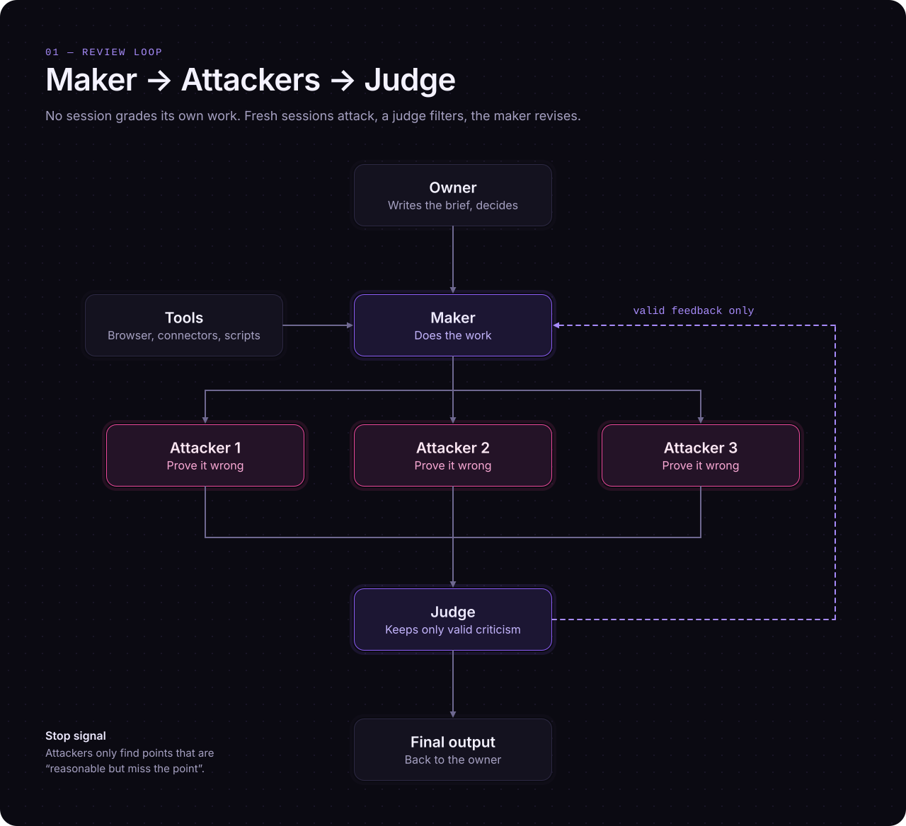
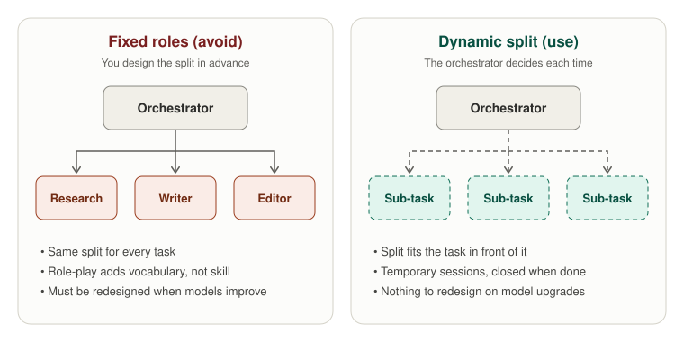
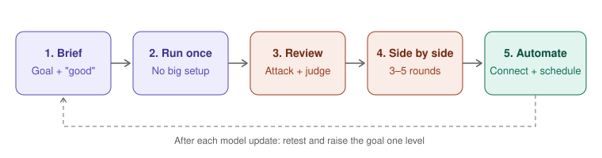

# AI Agent Builder

A lean, practical method for building AI agents you can actually trust.

Most people still use AI as a fancy autocomplete: copy data in, paste the answer out, repeat. This repo is a system for the opposite: give the agent access, define what *good* means, and never let a single session grade its own work.

It ships as:

- a **Claude skill** ([`skill/ai-agent-builder/SKILL.md`](skill/ai-agent-builder/SKILL.md)) that runs the method for you
- a **copy-paste prompt library** ([`prompts/prompts.md`](prompts/prompts.md))
- an **Agent Brief template** plus a worked example ([`templates/`](templates/))

---

## The three rules

| # | Rule | Why |
|---|------|-----|
| 1 | **Don't be the conveyor belt.** | If you hand-carry data to the AI, *you* are the bottleneck. Give it tools and access. |
| 2 | **Define "good", not a persona.** | "You are an expert X" adds vocabulary, not skill. Ask for the steps and tools a professional would use. |
| 3 | **No self-grading.** | One session judging its own work is unreliable. Use separate attacker and judge sessions. |

---

## How the review loop works



1. **Maker** does the task using the brief and the tools it has been given.
2. **Attackers** (3–5 fresh, parallel sessions) have one job: prove the output is wrong. A smaller, cheaper model is fine here, because finding flaws is easier than creating.
3. **Judge** reviews every criticism and keeps only what is valid and actionable.
4. **Maker** gets only the validated feedback, decides what to act on, and revises.

**Stop signal:** when the attackers can only find points that are "reasonable but miss the point", the output is probably good.

**Prefer hard evidence:** another session is a useful outside signal, but passing tests, primary sources and real user behaviour are better.

---

## One orchestrator, no fixed roles



You don't build a cast of "Research Agent / Writer Agent / Editor Agent". Instead:

- **One Project per work item.** The Project *is* the agent. Its instructions are a short Agent Brief.
- **The main session is the orchestrator.** For every task it decides how to split the work and opens temporary sub-sessions, then closes them.
- **Nothing to redesign** when models improve. The split is decided fresh every time.

What you write:

```
1 skill (the method, written once)
   ├─ Agent Brief: weekly sales report
   ├─ Agent Brief: invoice processing
   └─ Agent Brief: market research
```

---

## Defining "good": the weather test

Ask an agent for the current temperature.

| Result | Verdict |
|--------|---------|
| Guessed a number, and it happened to be right | ❌ **Fail.** The process was unreliable. |
| Off by 0.5°, but used the right location and a reputable source | ✅ **Pass.** The process can be trusted. |

**Good = correct result + trustworthy process.** Every brief includes pass and fail criteria, and a guessed detail always counts as a failure.

For taste-driven work (writing, design) where quality is hard to measure:

- ask for **several variations** instead of one "make it good" output
- ask for the **strongest counter-argument** to your draft
- judge by whether a real user can use it quickly, without explanation

---

## Build procedure



1. **Brief:** write the goal and the definition of done ([template](templates/agent-brief.md)).
2. **Run once:** no big plans or setup before the first real run.
3. **Review:** attackers, then the judge, then the maker revises.
4. **Side by side:** for 3–5 rounds, review the same item yourself *and* let the agent review it. Compare, then fix the brief where you differ.
5. **Automate:** add connectors and schedules only once results are reliable.

After each model update, retest without old skills or long prompts, keep only what clearly helps, and raise the goal one level.

---

## Matching review effort to risk

| Task | Review |
|------|--------|
| Low stakes (a quick draft) | Maker only, plus a self-check (P8) |
| Facts and numbers | One fact-check session with primary sources (P6) |
| Important output (reports, money, legal, production code) | Full loop: Attackers → Judge → Revision (P3 → P4 → P5) |

Start with **one** attacker and add more only if mistakes still slip through.

**Always ask a human first** before anything irreversible: sending, submitting, paying or deleting.

---

## Turning your feedback into rules

The last bottleneck is usually the human reviewing everything. Shrink it in three steps:

1. **Collect** every piece of feedback you have given on past outputs.
2. **Condense** it into a list of principles.
3. **Surface hidden beliefs:** ask *"Which principles do I follow but have never written down?"*

Add the list to the Agent Brief and to the attacker prompts. Reviews start to sound like you.

---

## Quick start

### Use it as a Claude skill

1. Copy [`skill/ai-agent-builder/`](skill/ai-agent-builder/) into your skills folder, or upload `SKILL.md` as a skill in Claude.
2. Ask something like: *"Help me build an agent that prepares my weekly sales report."*
3. The skill walks you through the brief, the first run and the review loop.

### Install from the terminal (Claude Code)

There is nothing to build or install with a package manager. You only clone the repo and copy the skill folder into your Claude Code skills directory.

**macOS / Linux**

```bash
git clone https://github.com/py-www/ai-agent-builder.git
mkdir -p ~/.claude/skills
cp -r ai-agent-builder/skill/ai-agent-builder ~/.claude/skills/
```

**Windows (PowerShell)**

```powershell
git clone https://github.com/py-www/ai-agent-builder.git
New-Item -ItemType Directory -Force "$HOME\.claude\skills"
Copy-Item -Recurse ai-agent-builder\skill\ai-agent-builder "$HOME\.claude\skills\"
```

Restart Claude Code to load the skill. To install it for one project only, copy it into that project's `.claude/skills/` folder instead.

To update later, run `git pull` inside the cloned repo and copy the folder again.

### Use it by hand

1. Copy [`templates/agent-brief.md`](templates/agent-brief.md) into a new Claude Project's instructions and fill it in.
2. Run the task in that Project.
3. Paste the output into new chats with the prompts in [`prompts/prompts.md`](prompts/prompts.md): P3 (attacker) → P4 (judge) → P5 (revision).

---

## Repo structure

```
ai-agent-builder/
├── README.md
├── .gitignore
├── skill/
│   └── ai-agent-builder/
│       └── SKILL.md          # the method as a Claude skill
├── prompts/
│   └── prompts.md            # P1–P8 copy-paste prompts
├── templates/
│   ├── agent-brief.md        # blank Agent Brief
│   └── example-brief.md      # filled-in example
└── docs/
    └── images/               # diagrams used in this README
```

---

## Principles at a glance

| # | Principle | Action |
|---|-----------|--------|
| 1 | Don't be the conveyor belt | Give access, not copy-paste |
| 2 | Work items, not roles | One Project per work item; the orchestrator splits work each time |
| 3 | Method, not costume | Ask for the professional's process |
| 4 | Define good | Right answer **and** trustworthy method |
| 5 | Tools over data dumps | Browser first, connectors later |
| 6 | Skills expire | A/B test with vs. without after model updates |
| 7 | No self-grading | Maker → Attackers → Judge |
| 8 | Codify taste | Collect → condense → surface hidden rules |
| 9 | Earn trust | Run side by side before handing over |
| 10 | Attention is scarce | Prototype wide, show only the best few |

---

## License

[MIT](LICENSE)
